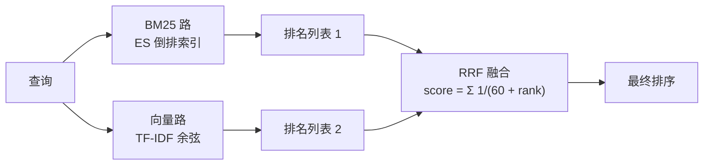

# hybrid-search-demo

[](https://www.python.org/)
[](https://www.elastic.co/)
[](https://www.docker.com/)
[](LICENSE)

一个可以直接跑的混合检索对比实验：同一份医疗语料上，对比 **BM25（Elasticsearch）**、**纯向量**、**RRF 混合** 三种策略，并演示术语陷阱——`PD-1` 和 `PD-L1` 在语义向量里为什么会混。

## 背景

医疗、金融这类领域的查询天然分两类，单一策略覆盖不了：

- **术语类**：药名、病名、器械型号、试验编号——字面不同就是不同东西，需要精确匹配
- **描述类**：症状、主诉、口语化描述——同一个意思有几十种说法，需要语义泛化

所以双路召回 + 融合是正确做法，而不是二选一。这个实验把这件事具体跑出来看。

## 架构



**为什么融合用排名倒数而不是分数加权**：BM25 分数无上界且随文档长度漂移，cosine 落在 [-1, 1]，量纲不可比；排名是无量纲的天然归一化，融合更稳。

## 实验设计

- 语料：25 条医疗文档（`medical_corpus.json`）
- 查询：14 条，全部标注 `gold`（期望命中的 doc id）和 `type`：

| 类型 | 条数 | 例子 | 考什么 |
|---|---|---|---|
| terminology | 6 | 药名、器械型号 | 字面精确匹配 |
| semantic | 6 | 症状口语描述 | 语义泛化 |
| trap | 2 | PD-1 / PD-L1 | 术语陷阱：一字之差的两个不同东西 |
- 指标：top-3 命中率（gold 出现在返回前 3 即命中）

## 实测结果（本地版，`local_compare.py`）

```
语料 25 条 | 查询 14 条 | top_k=3 | RRF k=60
（本地 BM25 实现：jieba 分词 + k1=1.2 / b=0.75，非真实 Elasticsearch）
```

| 策略 | 术语类 (6) | 描述类 (6) | 陷阱类 (2) | 综合 (14) |
|---|---|---|---|---|
| BM25 | 100% | 83.3% | 100% | 92.9% |
| 纯向量（TF-IDF） | 100% | 83.3% | 100% | 92.9% |
| RRF 混合 | 100% | 83.3% | 100% | 92.9% |

**术语陷阱明细**（重点看加粗项）：

| 查询 | gold | BM25 top-3 | 纯向量 top-3 | RRF top-3 |
|---|---|---|---|---|
| `PD-1` | D02, D19 | D19, D02, D03 | D19, D02, **D03 ⚠** | D19, D02, D03 |
| `PD-L1` | D03, D19 | D19, D03, D02 | D19, D03, **D02 ⚠** | D19, D03, D02 |

**怎么读这组数字**：25 条的小语料上，三策略命中率打平——词表窄，策略差异还不足以翻转排名。但术语漂移已经出现了：纯向量在 `PD-1` 的 top-3 里混进了 D03（PD-L1 的文档），在 `PD-L1` 里混进了 D02。换成真实稠密 embedding 或更大的语料，这个漂移会放大。这个 demo 的价值不在命中率数字，在陷阱现象本身——只走单路召回时，错误就是这样悄悄进来的。

## 快速开始

### 方式 A：真实 Elasticsearch（推荐）

```bash
# 1. 启动 ES 单节点（首次拉镜像后等 40~60 秒）
docker compose up -d

# 2. 装依赖
pip install -r requirements.txt

# 3. 建索引 + 灌数据（25 条语料）
python prepare_and_load.py

# 4. 跑三策略对比
python compare.py
```

### 方式 B：无 Docker 的轻量版（上面的数字就是它跑出来的）

```bash
pip install jieba numpy
python local_compare.py
```

jieba 分词 + BM25 打分（与 ES 相同超参 k1=1.2 / b=0.75），向量侧和 RRF 逻辑与方式 A 完全一致。先验证策略方向，跑通真 ES 后以 ES 实测为准。

### 可选：Kibana

```bash
docker compose --profile kb up -d   # http://localhost:5601
```

## 两个工程细节

**1. 中文分词**：ES 官方镜像默认没有 IK 中文分词插件，BM25 对中文直接失效。处理办法是 Python 侧 jieba 预分词 + 双字段索引（`text` 原文 + `text_standard` 预分词结果），保证 BM25 一定能命中中文词，不依赖任何 ES 插件。

**2. 向量侧为什么用 TF-IDF 不用真 embedding**：零外部依赖——不调 embedding API、不下载模型，clone 下来就能跑。代价是 TF-IDF 强度弱于稠密向量，会放大术语漂移——而这正是实验想演示的现象。换成真实 embedding 只需替换 `compare.py` 里的 `build_tfidf_matrix()` 和 `vector_search()` 两个函数。

## 代码导读

| 文件 | 职责 |
|---|---|
| `local_compare.py` | 无 Docker 版：jieba + BM25 + TF-IDF + RRF，纯 numpy 实现 |
| `prepare_and_load.py` | 建索引（双字段）+ 灌数据 + 生成查询集 |
| `compare.py` | 真实 ES 上的三策略对比 |
| `medical_corpus.json` | 25 条语料 + 14 条标注查询，换成任何垂直领域语料都可以 |

## License

MIT，见 [LICENSE](LICENSE)。
